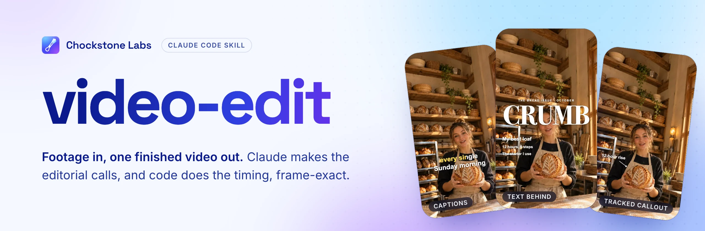
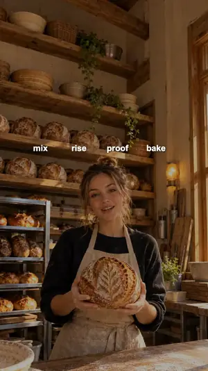

<a href="https://chockstonelabs.com/apps/?utm_source=github&utm_medium=readme&utm_campaign=video-edit#skills">
  <picture>
    <source media="(prefers-color-scheme: dark)" srcset=".github/readme/banner-dark.webp">
    
  </picture>
</a>

<p align="center">
  <a href="#install"><b>Install</b></a>&nbsp;&nbsp;·&nbsp;&nbsp;
  <a href="#what-it-makes"><b>What it makes</b></a>&nbsp;&nbsp;·&nbsp;&nbsp;
  <a href="#how-an-edit-runs"><b>How an edit runs</b></a>&nbsp;&nbsp;·&nbsp;&nbsp;
  <a href="https://chockstonelabs.com/?utm_source=github&utm_medium=readme&utm_campaign=video-edit"><b>Chockstone Labs</b></a>
</p>

<p align="center">
  
  
  
  
</p>

<br>

video-edit is the skill Claude Code loads when you ask it to edit footage. Give it a folder of
takes and it plans the story, cuts in the pauses between words, adds captions and motion
graphics, grades, mixes to -14 LUFS and renders one file ready to post.

Claude picks lines by number and shots by id, never a timestamp. Python and Swift scripts turn
those picks into frame-exact cuts through one edit decision list, so a cut never clips a word.

## What it makes

These clips come from the field guide in [`guide/`](guide).

<table>
  <tr>
    <td align="center" width="33%"><br><b>Karaoke captions</b><br><sub>Each word fills as it is said</sub></td>
    <td align="center" width="33%"><br><b>Magazine cover</b><br><sub>The masthead sits behind her head</sub></td>
    <td align="center" width="33%"><br><b>Tracked callout</b><br><sub>A label follows the loaf</sub></td>
  </tr>
  <tr>
    <td align="center"><br><b>Before and after</b><br><sub>A divider drags across one frame</sub></td>
    <td align="center"><br><b>Chart grow</b><br><sub>Bars rise, values count up</sub></td>
    <td align="center"><br><b>Orbit</b><br><sub>Words pass behind her on the far side</sub></td>
  </tr>
</table>

Six looks, one per video, each a single ffmpeg filter chain:

<table>
  <tr>
    <td align="center"><br><sub>Clean bright</sub></td>
    <td align="center"><br><sub>Warm film</sub></td>
    <td align="center"><br><sub>Teal and orange</sub></td>
    <td align="center"><br><sub>Faded matte</sub></td>
    <td align="center"><br><sub>Golden hour</sub></td>
    <td align="center"><br><sub>Black and white</sub></td>
  </tr>
</table>

## How an edit runs

1. **Look.** `probe.py` and `sheet.py` read every file: its levels and whether a take has any
   speech, so a silent demo plays as footage instead of being cut as dead air.
2. **Transcribe.** An aligner times every word against the audio, with numerals spelled out
   first because aligners cannot time digits.
3. **Plan.** Claude keeps and drops lines by index, picks the hook, and places B-roll and
   interludes.
4. **Cut.** `quiet.py snap` moves each cut into measured quiet, outward and never inward.
   `edl.py check` reports pacing before anything renders.
5. **Layer and mix.** Captions stay in the safe zone and off faces (`place.py`), takes are
   matched, music sits 15 to 20 dB under speech, and the master lands at -14 LUFS and -1 dBTP.
6. **Render and check.** One render at CRF 15 or better, then `edl.py qa` checks format, frame
   count, sync and loudness, saves a frame after every change, and on macOS reads the text on
   screen for personal details.

Every stage reads and writes the same JSON file, so stages swap freely: cut in ffmpeg, then
layer in Remotion or Blender.

```json
{"fps": 30, "size": [1080, 1920],
 "sources": {"t1": {"path": "work/IMG_1.mp4", "words": "work/IMG_1.words.json"}, "b1": "broll/pour.mp4"},
 "segments": [{"src": "t1", "in": 1.2, "out": 6.85, "why": "lines 0-2, the payoff"},
              {"src": "t1", "in": 9.4, "out": 14.0, "transition": {"type": "fade", "frames": 16}},
              {"src": "b1", "in": 0.3, "out": 15.3, "gain_db": -12, "afade": 0.25, "why": "interlude"}],
 "cutaways": [{"src": "b1", "in": 0.3, "out": 3.3, "at": 4.0, "fade": 6, "why": "shows the pour"}],
 "limits": {"min_shot": 2.0, "min_save": 0.6, "cutaway": [2, 6], "max_len": 180}}
```

## Install

```bash
git clone https://github.com/chriscrosscutler/video-edit ~/.claude/skills/video-edit
```

Then ask Claude Code for an edit in plain words, for example "cut these three takes into a
40-second Reel with captions". The skill loads on its own.

You need:

- Python 3.10 or newer and ffmpeg 7 or newer on the PATH.
- macOS with the Xcode command line tools for the Swift vision tools (`faces`, `ocr`, `track`,
  `matte`, `cover`). They build on first use into `~/.cache/video-edit/`.
- Node for the Remotion templates, and Blender 5.2 LTS for `blender_title.py`
  ([references/blender.md](references/blender.md)).

## Edit Chockstone posts

[Chockstone Labs](https://chockstonelabs.com/?utm_source=github&utm_medium=readme&utm_campaign=video-edit)
is a social media manager whose iPhone app records, cuts and renders video. Connect its
[MCP server to Claude](https://chockstonelabs.com/social/claude/?utm_source=github&utm_medium=readme&utm_campaign=video-edit)
and video-edit changes a post's edit list by line number: drop a line, trim a take, split after
a word. The phone renders the result. See [references/chockstone.md](references/chockstone.md).

## Layout

| Path | What it holds |
|---|---|
| [`SKILL.md`](SKILL.md) | The rules every edit follows, loaded on each use |
| [`references/`](references) | One file per stage (plan, cut, captions, audio, grade, motion, render, compliance), read when a task needs it |
| [`scripts/`](scripts) | Python (standard library only) and Swift tools; each prints its flags with `--help` |
| [`templates/remotion/`](templates/remotion) | Caption, look and layout components plus `brand.json` |
| [`tests/`](tests) | `test_scripts.py` (needs ffmpeg) and `test_vision.py` (macOS, Apple Vision) |
| [`guide/`](guide) | The illustrated field guide to every effect and look, with its demo clips |

## Tests

```bash
python3 tests/test_scripts.py
python3 tests/test_vision.py
```

The Blender and Swift tests skip when those tools are missing. To read the field guide, open
`guide/index.html` in a browser from this folder so the `img/` paths resolve.

<br>

<p align="center">
  <a href="https://chockstonelabs.com/?utm_source=github&utm_medium=readme&utm_campaign=video-edit"></a>
</p>
<p align="center">
  Made by <a href="https://chockstonelabs.com/apps/?utm_source=github&utm_medium=readme&utm_campaign=video-edit"><b>Chockstone Labs</b></a>, a small app studio in Chagrin Falls, Ohio.<br>
  We also make <a href="https://capnolog.com">Capnolog</a>, <a href="https://spotmeter.app">SpotMeter</a>, <a href="https://capysort.com">Capysort</a> and <a href="https://lightdrills.com">LightDrills</a>, and the <a href="https://github.com/chriscrosscutler/humanize">humanize</a> skill.
</p>
